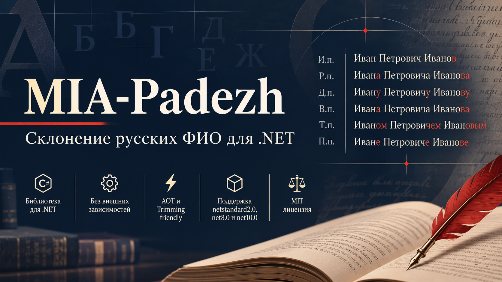

<div align="center">

# MIA-Padezh

### Склонение русских фамилий, имён и отчеств для .NET

**Современная библиотека для морфологической обработки русских ФИО.**

Детерминированная логика · Нулевые зависимости · Высокая точность · AOT-friendly

[Возможности](#-возможности) · [Быстрый старт](#-быстрый-старт) · [Примеры](#-примеры-использования) · [Архитектура](#-архитектура)

[](https://dotnet.microsoft.com/)
[](https://learn.microsoft.com/dotnet/csharp/)
[](LICENSE)
[](https://github.com/chelslava/MIA-Padezh/stargazers)

</div>

---

## О проекте

**MIA-Padezh** — библиотека на C# для автоматического склонения русских фамилий, имён и отчеств по грамматическим падежам.

Проект представляет собой современное развитие подхода Petrovich с расширенными возможностями, улучшенными правилами и собственной системой проверки качества на большом корпусе словоформ.

Библиотека предназначена для использования в корпоративных информационных системах, CRM, документообороте, генерации писем, персонализированных уведомлениях, API и других приложениях, где требуется грамматически корректная обработка русских ФИО.

Главный принцип проекта — **предсказуемость и независимость от внешних сервисов**.

Вся логика склонения выполняется локально, без обращения к интернету, нейросетям или сторонним API.

## ✨ Возможности

| Возможность | Описание |
|---|---|
| Шесть падежей | Именительный, родительный, дательный, винительный, творительный и предложный |
| Полная обработка ФИО | Склонение фамилии, имени и отчества как по отдельности, так и целиком |
| Определение рода | Автоматическое определение рода по имени и отчеству |
| Словарь имён | 1 765 записей для повышения точности определения рода |
| Множественное число | Склонение фамилий, имён и отчеств во множественном числе |
| Звательный падеж | Разговорный и церковный стили |
| Неоднозначные имена | Возможность явно передать род для имён вроде Саша и Женя |
| Составные ФИО | Поддержка дефисных имён и фамилий |
| Неизменяемые фамилии | Корректная обработка фамилий, которые не склоняются |
| Национальные фамилии | Поддержка различных национальных морфологических классов |
| Высокая производительность | Правила преобразованы в C#-код на этапе сборки |
| Zero Dependencies | Отсутствие внешних зависимостей |
| Native AOT | Совместимость с Native AOT и trimming |

## 🚀 Технологии

- C# / .NET
- `netstandard2.0`
- `.NET 8`
- `.NET 10`
- Source Generation
- Native AOT
- Trimming
- Unit Testing

## ⚡ Быстрый старт

Пространство имён:

```csharp
using MIA.Padezh;
```

### Склонение полного ФИО

```csharp
// Склоняем полное ФИО в дательный и родительный падежи.
var name = RuName.Parse("Иванов Пётр Сергеевич");

var dative = name.Decline(Case.Dative);
// Иванову Петру Сергеевичу

var genitive = name.Decline(Case.Genitive);
// Иванова Петра Сергеевича
```

### Склонение отдельных частей

```csharp
// Склоняем фамилию, имя и отчество независимо.
var lastName = Padezh.Decline(
    NamePart.LastName,
    "Иванов",
    Case.Genitive
);

var firstName = Padezh.Decline(
    NamePart.FirstName,
    "Анна",
    Case.Dative
);

var middleName = Padezh.Decline(
    NamePart.MiddleName,
    "Сергеевич",
    Case.Instrumental
);
```

### Определение рода

```csharp
// Определяем род по имени и отчеству.
var gender = Padezh.DetectGender(
    NamePart.MiddleName,
    "Ивановна"
);

// Gender.Female
```

### Множественное число

```csharp
// Склоняем фамилию во множественном числе.
var family = Padezh.DeclinePlural(
    NamePart.LastName,
    "Иванов",
    Case.Genitive
);

// Ивановых
```

### Звательный падеж

```csharp
// Разговорная форма обращения.
var informal = Padezh.Decline(
    NamePart.FirstName,
    "Саша",
    Case.Vocative
);

// Саш

// Церковный стиль.
var church = Padezh.Decline(
    NamePart.FirstName,
    "Пётр",
    Case.Vocative,
    Gender.Male,
    VocativeStyle.Church
);

// Пётре
```

## 📖 Поддерживаемые падежи

| Падеж | Вопрос | Пример |
|---|---|---|
| Именительный | Кто? | Иванов Пётр Сергеевич |
| Родительный | Кого? | Иванова Петра Сергеевича |
| Дательный | Кому? | Иванову Петру Сергеевичу |
| Винительный | Кого? | Иванова Петра Сергеевича |
| Творительный | Кем? | Ивановым Петром Сергеевичем |
| Предложный | О ком? | Иванове Петре Сергеевиче |

## 🎯 Точность и качество

MIA-Padezh проверяется на большом корпусе реальных словоформ, а не только на вручную подготовленных примерах.

В качестве эталона используется корпус `petrovich-eval`, содержащий около 248 000 форм единственного числа.

### Результаты проверки

| Часть ФИО | Количество форм | Точность |
|---|---:|---:|
| Фамилии | 100 980 | **99,89%** |
| Имена | 76 422 | **99,63%** |
| Отчества | 97 626 | **100%** |

Дополнительно используются:
- Golden tests для проверки эталонных случаев.
- Юнит-тесты библиотеки.
- Проверка национальных морфологических классов.
- Сравнение результатов с исходным корпусом.

## 🧠 Нейро-fallback (опционально)

Для фамилий, которых нет в словаре правил (иностранные, новые), существует отдельный пакет **MIA.Padezh.Neural**.

Компактная нейросетевая модель (ONNX, около 0,5 млн параметров), обученная на корпусе petrovich-eval, вызывается только тогда, когда ни одно правило не подошло. Правила всегда остаются в приоритете.

```csharp
using MIA.Padezh.Neural;

using var padezh = new NeuralPadezh();

var ruled = padezh.DeclineLastName("Иванов", Case.Genitive);
// Иванова — детерминированное правило

var raw = padezh.DeclineRaw("шварценеггер", Case.Genitive, Gender.Male);
// шварценеггера — прямой вызов модели (для экспериментов)
```

Ядро MIA.Padezh при этом остаётся с нулевыми зависимостями — ONNX-зависимость живёт только в MIA.Padezh.Neural. Модель соло даёт ~91% на holdout корпуса (обучение — `training/`), гибрид сохраняет 99,88% правил.

Подробнее: [data/CHANGES-v0.5-neural.md](data/CHANGES-v0.5-neural.md), скрипты обучения — [training/](training/).

## 🏗 Архитектура

Одна из ключевых особенностей MIA-Padezh — отсутствие обработки JSON-правил во время выполнения программы.

Правила склонения компилируются в исходный C#-код специальным инструментом.

```text
MIA-Padezh/
│
├── data/
│   ├── rules.json
│   ├── plural.json
│   ├── gender.json
│   └── CHANGES-*.md
│
├── src/
│   ├── MIA.Padezh/
│   │   ├── Generated/
│   │   └── Core
│   └── MIA.Padezh.Neural/
│       └── Models/ (ONNX)
│
├── tools/
│   ├── MIA.Padezh.RulesGen/
│   └── MIA.Padezh.Eval/
│
├── training/ (Python: подготовка данных и обучение нейро-fallback)
│
├── tests/
│   └── testdata/
│
├── .github/
│   └── workflows/
│
├── LICENSE
├── README.md
└── MIA.Padezh.slnx
```

### Генерация правил

Для обновления сгенерированных таблиц используется RulesGen:

```bash
dotnet run --project tools/MIA.Padezh.RulesGen
```

Генератор:
1. Загружает исходные правила.
2. Проверяет корректность структуры и значений.
3. Преобразует правила в C#-представление.
4. Обновляет `Generated/RulesTable.g.cs`.

Такой подход позволяет отказаться от JSON-парсинга в runtime и упрощает использование библиотеки в AOT-приложениях.

## ⚖️ Сравнение с аналогами

| Возможность | MIA-Padezh | NPetrovich | NPetrovichLite |
|---|---|---|---|
| Внешние зависимости | Нет | Есть | Нет |
| Правила в runtime | C# | JSON | JSON |
| AOT / Trimming | Да | Нет | Нет |
| Множественное число | Да | Ограничено | Ограничено |
| Звательный падеж | Да | Нет | Нет |
| Словарь рода | Да | Нет | Нет |
| Современные .NET | Да | Ограничено | Ограничено |

## 🗺 Дорожная карта

- [x] Базовые правила склонения.
- [x] Шесть грамматических падежей.
- [x] Автоматическое определение рода.
- [x] Словарь имён.
- [x] Склонение во множественном числе.
- [x] Разговорный звательный падеж.
- [x] Церковный звательный падеж.
- [x] Поддержка национальных фамилий.
- [x] Корпусная проверка качества.
- [x] Опциональный нейросетевой fallback на базе ONNX для случаев, не покрытых правилами.
- [ ] Дальнейшее расширение корпуса и тестовых сценариев.

## 📦 Лицензия

Проект распространяется под лицензией **MIT**.

Это означает, что библиотеку можно свободно использовать в личных, коммерческих и корпоративных проектах с соблюдением условий лицензии.

Подробнее: [LICENSE](LICENSE).

## 🤝 Участие в разработке

MIA-Padezh — Open Source проект. Приветствуются предложения по улучшению правил склонения, новые тестовые случаи, сообщения об ошибках и Pull Request.

Если проект оказался полезным, поставьте ⭐ репозиторию — это помогает его развитию.

[GitHub Repository](https://github.com/chelslava/MIA-Padezh)

---

<div align="center">

**MIA-Padezh**

*Грамотный русский язык. Точная обработка. Современный .NET.*

Made with ❤️ and C#

</div>

---

## English

**MIA-Padezh** is a modern .NET library for Russian full-name declension.

It supports all six grammatical cases, automatic gender detection, plural forms, vocative forms, hyphenated names and non-declinable surnames.

Key features:

- Zero external dependencies.
- Deterministic rule-based processing.
- AOT and trimming friendly.
- Rules compiled into C# source at build time.
- Targets `netstandard2.0`, `net8.0` and `net10.0`.
- Validated against a large Russian name-form corpus.

Licensed under MIT.
